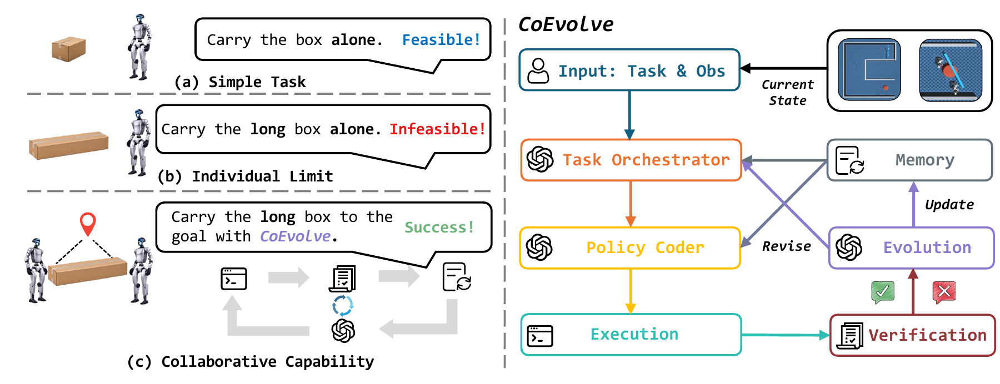
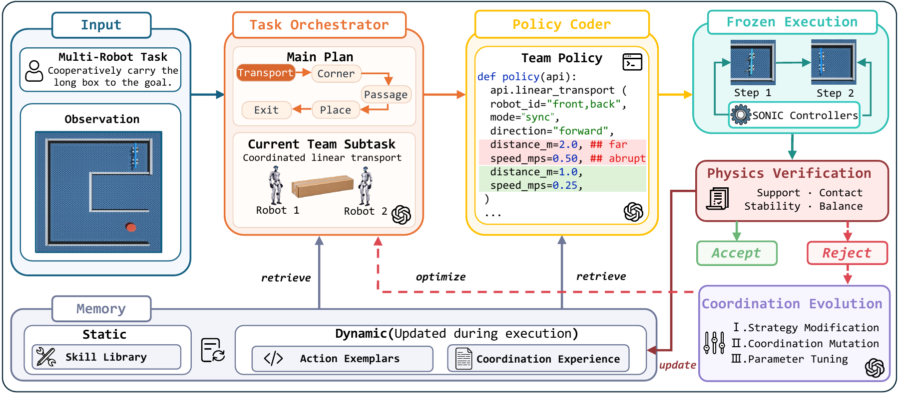
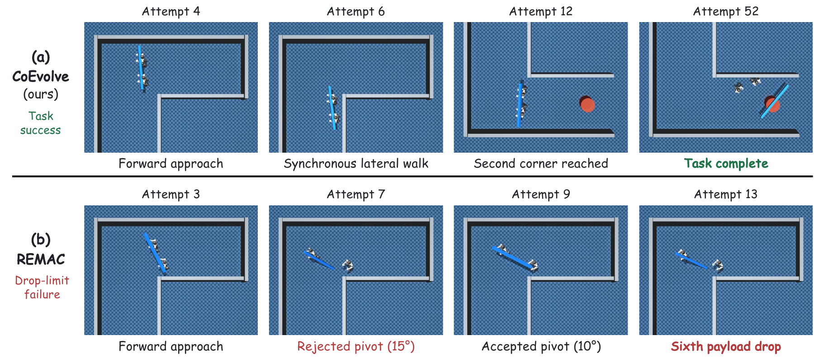
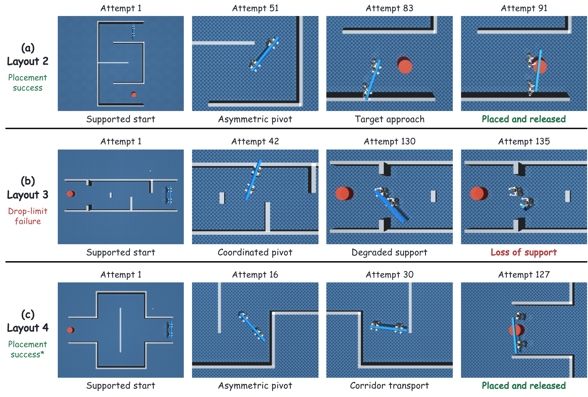
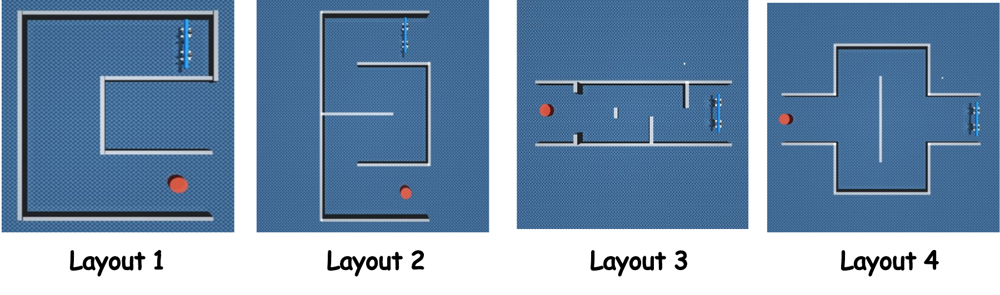
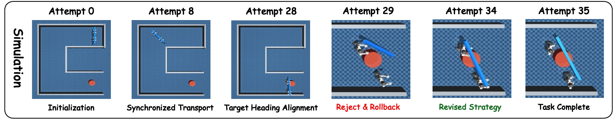

# CoEvolve

CoEvolve studies **verified self-evolution of cooperative robot programs**.
Two Unitree G1 humanoids carry and place a free payload in MuJoCo using frozen
SONIC whole-body control. Foundation models plan, generate and repair
low-frequency programs; physical verifiers decide acceptance, rollback and
completion.



## Quick start

Python 3.10+; run from the repository root:

```bash
python3 -m venv .venv
source .venv/bin/activate
python -m pip install -e '.[dev]'
coevolve-experiments --help
coevolve-experiments validate-scenes --mode planning
coevolve-experiments adapter-smoke --method all
python -m pytest -q tests/maintenance tests/experiments/test_cli.py
```

These checks need no model credentials or simulator. They test software
contracts, **not physical task performance**. The Python distribution retains
its historical name, `praxis-coop`.

For physical experiments, follow [installation](ENV_SETUP.md) and
[the run guide](docs/REPRODUCTION.md). SONIC binaries, dependencies and authorized
weights must be acquired separately. The generic production CLI is not a turnkey
live launcher: its unimplemented worker boundary deliberately exits with code 78.

## How it works



1. A task orchestrator selects a cooperative objective and robot roles.
2. Generated programs pass Host admission and execute through the Skill SDK.
3. Physics/state checks accept progress or restore a certified checkpoint.
4. Scoped repair and verified experience inform subsequent proposals.

Foundation models do not run in the high-frequency motor loop. Checkpoint
rollback restores simulator state; it is not a physically executed reverse
trajectory. Framework code is illustrative; use the [API guide](docs/API.md)
for callable interfaces.

## Experiments

| Evaluation | Conditions | Observed successes |
| --- | --- | --- |
| Backbones | GPT / Gemini / Claude, 5 runs each | Full task: 3/5, 3/5, 2/5 |
| Baselines and components | 6 alternatives, 5 runs each; historical Full reference | Alternatives: 0/5 each; Full: 3/5 |
| Additional layouts | Layouts 2–4, 3 runs each | Placement and release: 1/3, 0/3, 1/3 |
| Experience reuse | GPT / Gemini / Claude → GPT, 5 runs each | Placement and release: 1/5, 2/5, 0/5 |

These are 69 selected logical cases, including disclosed continuations. The
Full comparison reuses the GPT backbone cohort; it is not five additional
samples. Runtime revisions, budgets and continuation protocols differ, so these
are descriptive comparisons, not uniformly fresh, runtime-matched ablations.
See [baseline adaptations](docs/BASELINES.md).



Selected base-task examples: Full completes placement, release and retreat;
REMAC reaches a drop-limit terminal. These are not average trajectories.



Layouts 2 and 4 reach placement and release without the base-task retreat.
Layout 3 ends at the drop limit. Layout 4 uses revised corridor verification,
so this is not an isolated geometry-only generalization comparison.

<details>
<summary>Layouts and local repair example</summary>



Layout diagrams show geometry, not prescribed robot trajectories.



The rollback panel marks checkpoint restoration. Attempt IDs are not charged
physical-transaction counts; the example is not an additional evaluation sample.

</details>

The [figure manifest](docs/assets/figures/manifest.json) records public image
integrity and dimensions. Raw runs, result exports, private manuscript provenance
and historical qualification pins are not distributed.
The figures and overview do not replace the original experiment evidence.

## Documentation

| Guide | What it covers |
| --- | --- |
| [Environment setup](ENV_SETUP.md) | Dependencies, SONIC patches and model-provider configuration |
| [Run guide](docs/REPRODUCTION.md) | Offline tests, four-terminal startup, parallelism and recovery |
| [API](docs/API.md) | Python/CLI interfaces, robot skills and local transports |
| [Architecture](docs/ARCHITECTURE.md) | Code organization and module boundaries |
| [Baselines](docs/BASELINES.md) | Implemented comparisons and departures from original methods |
| [Tests](tests/README.md) | Offline regressions and optional SONIC integration checks |
| [Contributing](CONTRIBUTING.md) | Development and review conventions |

## Repository scope and limitations

`src/` contains reusable code, including baseline implementations. `scripts/`
contains 18 reviewed setup, execution and validation entrypoints, listed in
the [run guide](docs/REPRODUCTION.md#script-catalog). `tests/` and `tools/`
support validation. Required
scene assets, configuration and integration patches are included.

All of `results/`, manuscript sources, internal notes, model weights, external
runtimes and the old `HaLyPO/` archive stay local. One-case repair scripts,
historical queue launchers and paper-result builders are not distributed.
The source SDK catalog lives in `src/praxis_coop/data/`.

This is simulation research software, not a certified real-robot safety system.
The generic Python executor is not a sandbox for untrusted programs. Keep
DDS/ZMQ on a trusted isolated network; no authenticated public control service
is provided. Local model loading may trust upstream Python code: review model
revisions before enabling it. Provider requests can disclose observations and
incur charges. Physical multi-experiment concurrency remains experimental.

Project licensing and third-party redistribution rights are pending confirmation.
Repository access alone does not grant an open-source license.
